# Rust Win16

<p align="center"></p>

<p align="center">
  <a href="https://github.com/liminal-hq-labs/rust-win16/actions/workflows/ci.yml"></a>
  
  
</p>

Build Windows 3.x programs in Rust: a code16 target, an NE packer and import stubs.

Rust `no_std` compiles for LLVM's `code16` mode, `rust-lld` links it, and a small Python packer places the code in 64 KB segments and writes a Win16 NE executable. A 948-byte message box, a 16 KB wizard-style installer and a 110 KB test program in five code segments come out the other end, and they run on Windows for Workgroups 3.11 and Wine (the first two on Windows ME too).

> **Status:** experimental. The examples build and run on Wine and Windows for Workgroups 3.11 (386 Enhanced mode, under DOSBox-X); the multi-segment example passed 40 of 40 runs there. Windows ME has run the single-segment examples. It has not been tried on real hardware, and the toolchain is an unsupported use of LLVM held together by a pinned compiler and our own packer.

## What it's for

- Writing a small native Windows 3.x program, such as an installer, a launcher or a utility, in Rust rather than C.
- Studying how an NE executable, the Win16 loader and the Pascal calling convention fit together, with a packer short enough to read.
- Starting a Win16 project with the register and loader traps already worked out.

## Requirements

- Rust 1.98.0 with the `rust-src` component. `rust-toolchain.toml` pins it, so `rustup` installs it on first use. The build sets `RUSTC_BOOTSTRAP=1` to get `-Zbuild-std` and a JSON target on that stable compiler, so no nightly is needed.
- `rust-lld`, which ships with the toolchain. No separate LLVM install is needed to build. `llvm-objdump` (any recent LLVM) is useful for reading the output with `-d -M i8086,intel`.
- Python 3.9 or later, with no packages.
- Optional, to run the result: Wine, or DOSBox-X with a Windows 3.11 tree you supply. See [Testing](#testing).

No Docker image is required. The spike this was cut from used the local toolchain for the Rust build and a container only for its Open Watcom C comparison, which is not part of this repository.

## Quick start

```sh
# Build msgbox, hello and setup into out/ (keep the Cargo output outside the tree if you like)
CARGO_TARGET_DIR=/tmp/w16-target bash scripts/build.sh

file out/MSGBOX.EXE        # MS-DOS executable, NE for MS Windows 3.x (3.10) (EXE), worded by your version of `file`
python3 tools/ne_dump.py out/MSGBOX.EXE
wine out/MSGBOX.EXE
```

A program is a `#![no_std]` binary that exports `w16_main(hinst, hprev, show)`:

```rust
#![no_std]
#![no_main]
use w16::*;

#[unsafe(no_mangle)]
pub extern "C" fn w16_main(_hinst: u32, _hprev: u32, _show: u32) -> u32 {
	unsafe { MessageBox(0, cs!("Hello from Rust"), cs!("Win16"), MB_OK) };
	0
}
```

To add a program, add a `[[bin]]` to `Cargo.toml`, add its name to the loop in `scripts/build.sh`, and put dialogs, strings and raw files in `examples/<name>/resources.json` if it needs them.

## Examples

| Example | What it shows |
|---|---|
| `msgbox` | One `MessageBox`: the smallest program, 948 bytes |
| `hello` | A window class, a message loop, painting, and a native three-page wizard dialog driven by a state machine |
| `setup` | A wizard, a modeless progress dialog with a message pump, a bundled file read from a resource and copied to `C:\W16TEST`, an INI receipt and a result log |
| `segmove` | Forces Windows to move the data segment while a `MessageBox` or a `GetOpenFileName` dialog is open and checks that the 32-bit stack followed it; `scripts/run-segmove.sh` runs it on Windows 3.11 many times |
| `bigseg` | 88 KB of code in five segments: calls, tail calls, function pointers, `dyn` and a jump table across all of them, a discardable segment thrown out and called again, each result checked against a second implementation; `BIGSEG /exit` writes `BIGSEG.LOG` and ends Windows |

## How the packer works

`tools/ne_pack.py` takes the linked ELF and writes the NE file Windows loads: the DOS stub, the NE header, the code segments, one automatic data segment with its stack and heap, the relocation records, the entry table, the name tables and the resource table. The linker leaves every function in a section of its own with its relocations; the packer places them in segments (automatically, by a `.text.seg<N>` section name or by Rust path patterns in a small JSON file), recomputes every reference to code and sends calls between segments through veneers with far fixups. [docs/packer.md](docs/packer.md) walks through each piece.

## Limits

- **A 386 or later.** Rust on `code16` leans on 32-bit registers through operand-size and address-size prefixes, so the programs need Windows 3.x in 386 Enhanced mode. Standard mode on a 286 is unsupported and is expected to fail with invalid opcodes.
- **64 KB segments.** Code may fill up to 253 segments of 64 KB each (the veneers and the slot table count); a single function must fit in one, and the file in 1 MB. Data is one segment (DS = SS) of 64 KB with the stack, the heap and a 1 KB shadow return stack counted in it.
- **Calls through function pointers or tail calls into another segment** use a shadow return stack, 256 levels deep by default (`--shadow`); direct calls have no such limit. Exported procedures and import stubs live in segment 1.
- **DPMI.** Rust runs on a 32-bit alias of the stack segment that the program makes through DPMI (see pitfall 7).
- **Untested on real hardware.** Wine, DOSBox-X running a real Windows for Workgroups 3.11, and Windows ME in a virtual machine have run the examples. Windows 3.0 and a physical 286 or 386 have not.
- **No allocator and no `core::fmt`.** The `alloc` crate builds, but nothing provides a global allocator, and formatting would cost tens of kilobytes of code.
- **A small API surface.** 64 imports from KERNEL, USER and GDI. Add more to `tools/imports.tbl` and regenerate.
- **Not done:** icons, DDE (so no Program Manager groups), DLLs, and more than one instance of a program.

## Testing

```sh
python3 -m unittest discover -s tests -v   # packer and stub generator
bash scripts/check-headers.sh
```

To run the executables:

- **Wine.** `wine out/SETUP.EXE` runs the whole flow. Wine keeps the high halves of the 32-bit registers intact and tolerates a few loader mistakes real Windows rejects, so a pass on Wine is a good smoke test, not proof.
- **DOSBox-X with Windows for Workgroups 3.11.** Install Windows 3.11 yourself (this repository ships no Microsoft files). `W31_TREE=DIR DOSBOX_IMAGE=IMAGE bash scripts/run-w31.sh --runs 30 out/BIGSEG.EXE /exit` runs a program on a fresh copy of the tree as many times as you ask and counts the passes. By hand: mount the tree as `C:` and a scratch directory as `D:`, and start `WIN /3`. The spike used `machine=svga_s3`, `cputype=pentium`, `ems=false`, put `run=D:\SETUP.EXE` in `WIN.INI` and drove the dialogs from the keyboard, since mouse input was unreliable. `SETUP` writes its log to `C:\W16TEST\RESULT.LOG` and `D:\RESULT.TXT`; the last line reads `RESULT: PASS` when it worked.
- **Windows ME or 9x** in a virtual machine runs Win16 programs too, and reports a 3.95 version to them.

## The seven register and loader pitfalls

Each of these worked on Wine or looked right on paper, and failed on a real Windows 3.11:

1. **Fixup chains.** Non-additive fixups are chained: Windows reads the next fixup's offset from the site it is about to patch, and 0xFFFF ends the chain. Leave zeros there and the loader walks to offset 0 and reports "Insufficient memory to run this application".
2. **The first 16 bytes of the data segment.** Windows writes the local-heap and stack bookkeeping there, so nothing of yours may live at those offsets. The linker script reserves them.
3. **INITTASK must run first.** It reads registers the loader set up. Any instruction before it, such as widening `sp` into `esp`, changes what it sees and the task dies.
4. **Resource lengths are in alignment units.** A resource table entry's length is shifted by the alignment, so a file that is a few bytes short makes a dialog silently fail to open. Pad the data and carry the exact length inside it.
5. **ES is not preserved.** Windows does not keep ES across a call, and Rust's `rep movs` uses it, so a later copy faults with a general protection fault. Reload ES from DS after every call.
6. **BX, and the high half of ESP, are not preserved.** A Pascal callee only owes SI, DI, BP and DS, and Windows also replaced EBX and, after yielding calls, left a non-zero high half in ESP. Save EBX, ESI, EDI and EBP around every API call, and clear the high half of ESP afterwards. Raw INT 21h clobbers registers the compiler believed safe, so inline assembly saves them too.
7. **Interrupts dirty ESP between any two instructions.** An interrupt that returns to a 16-bit stack segment restores only SP, so on Windows 3.11 the high half of ESP turns `8001` at timer ticks, about 20 times a second, and code16 addresses the stack through all of ESP. Rust runs on a 32-bit alias of the stack segment, which gets all of ESP back; the stubs move to the real 16-bit stack for each call into Windows and follow the data segment when Windows moves it.

The generated stubs and `export_proc!` do all of this for you. [docs/decisions.md](docs/decisions.md) records why.

## Documentation

- [SPEC.md](SPEC.md) — behaviour and interfaces
- [docs/packer.md](docs/packer.md) — how the NE packer and the import stubs work
- [docs/decisions.md](docs/decisions.md) — decisions and why
- [AGENTS.md](AGENTS.md) — contributor and agent rules

## Contributing

Issues and pull requests are welcome. The house rules are in [AGENTS.md](AGENTS.md); run the checks it lists before opening a pull request.

## Part of Liminal HQ Labs

Rust Win16 is a [Liminal HQ Labs](https://github.com/liminal-hq-labs) experiment. Experiments from Liminal HQ — early, rough and open. If it proves itself, it [graduates](https://github.com/liminal-hq-labs/.github/blob/main/docs/labs-charter.md#graduation) to [Liminal HQ](https://github.com/liminal-hq).

## Licence

Licensed under either of the [Apache License, Version 2.0](LICENSE-APACHE) or the [MIT licence](LICENSE-MIT), at your option.
