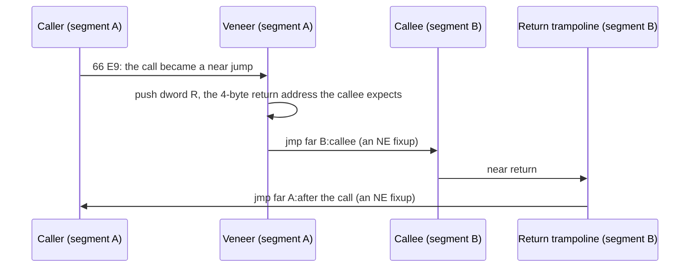

# How the packer and the import stubs work

The build has three stages: `rustc` and `rust-lld` produce a 32-bit x86 ELF, `tools/ne_pack.py` places its code in segments and writes a Win16 NE executable, and `tools/gen_imports.py` has already written the stubs that let Rust call Windows. This page explains each, and the Windows rules behind the odd parts.

## Table of contents

- [The target and the linker script](#the-target-and-the-linker-script)
- [The ELF the packer reads](#the-elf-the-packer-reads)
- [Code segments](#code-segments)
- [Calls between segments](#calls-between-segments)
- [Function pointers, `dyn` and jump tables](#function-pointers-dyn-and-jump-tables)
- [Load-on-call and discardable segments](#load-on-call-and-discardable-segments)
- [The 32-bit stack](#the-32-bit-stack)
- [The NE file it writes](#the-ne-file-it-writes)
- [Symbols the packer reads](#symbols-the-packer-reads)
- [Import stubs](#import-stubs)
- [Entry point and exported procedures](#entry-point-and-exported-procedures)
- [Resources](#resources)
- [Size limits](#size-limits)
- [Reading and testing the output](#reading-and-testing-the-output)

## The target and the linker script

`win16.json` is a custom target whose `llvm-target` is `i386-unknown-none-code16`. LLVM emits 16-bit code and uses the operand-size prefix (`66`) and address-size prefix (`67`) whenever Rust wants a 32-bit register or address, so a near pointer is a 32-bit value whose high half stays zero and a call between Rust functions is a 32-bit near call (`66 E8`). LLVM cannot emit a far call. The Rust ABI on this target passes the first arguments in ECX and EDX. Floating point is off and the panic strategy is abort. `.cargo/config.toml` builds `core` and `alloc` from source for it with `-Zbuild-std`, which needs `RUSTC_BOOTSTRAP=1` on a stable compiler.

`link.ld` puts `.data` at address 0, with `.rodata` and `.bss` folded into it (code reaches its strings through DS), and the first 16 bytes reserved, since Windows writes there. Data is final as linked. Code starts at 0x100000, well clear of any data offset, and the linker is run with three flags from `.cargo/config.toml`:

| Flag | Why |
|---|---|
| `--unique` | Every code section the script does not name becomes an output section of its own. Functions are in sections of their own already (`.text.<symbol>`), so each function arrives as a separate placement unit |
| `--emit-relocs` | The relocations stay in the output, so the packer can move a unit and fix every reference to it |
| `--noinhibit-exec` | A 16-bit relative jump between two sections far apart at these addresses is out of range for the linker, though not after packing; this turns that error into a warning. The packer checks undefined symbols itself |

## The ELF the packer reads

The packer reads section headers, the symbol table and the `.rel.*` sections, not program headers. Each executable section is a unit with its bytes, alignment and relocations; `.data` (and `.bss`, from an older linker script) is the automatic data segment 2. For every relocation that points into code, the packer recovers the addend from the bytes the linker wrote and recomputes the reference once the units have their final places. References to data are left as linked. An ELF without relocations is one unit and comes out exactly as linked; a single-segment program does too, since the layout matches the linker's.

## Code segments

Code segment 1 is fixed and preloaded. The data segment is 2. Further code segments are numbered 3 and up, without gaps, up to 254. Each unit goes to a segment by the first of these that applies:

1. **Pinned to segment 1:** `.text.start` (the entry point), `.text.exp_*` (exported procedures), `.text.imp_*` (import stubs) and `.text.w16fixed*` (runtime helpers that must run in segment 1).
2. **By section name:** `#[unsafe(link_section = ".text.seg4.name")]` on a function puts it in segment 4. Use a unique suffix per function, so each stays a unit of its own.
3. **By the segments file** (`--segments FILE.json`): the first segment, in number order, with a `place` pattern that matches the unit's demangled Rust path or its section name.
4. **Automatically:** what is left fills segment 1 up to its budget, then new segments in link order, each up to the automatic budget.

When nothing asks for a second segment and all the code fits in one segment (and segment 1's budget, if one is set), the program has one code segment and nothing below about veneers applies.

```json
{
	"segments": {
		"1": { "name": "MAIN", "budget": 24576 },
		"3": { "name": "COLD", "place": ["bigseg::cold::*"], "preload": false, "discardable": true }
	},
	"auto": { "budget": 40960 },
	"shadow": 256
}
```

| Key | Meaning |
|---|---|
| `segments."N".place` | Patterns (`fnmatch`, case-sensitive) matched against the demangled path, such as `w16::Log::dec`, `<bigseg::Rect as bigseg::Shape>::area` (the leading `<` may be left out of the pattern) or `core::fmt::*`, and against the section name, such as `.text.imp_MessageBox` |
| `segments."N".budget` | For segment 1, the bytes of code the automatic fill may put there. For other segments, a ceiling on the code their patterns place: the packer fails past it, which makes it a size gate for CI |
| `segments."N".preload` | `true` (default): loaded with the program. `false`: loaded on the first call |
| `segments."N".discardable` | `false` (default). `true`: Windows may throw the segment away under memory pressure and load it again when it is next called |
| `segments."N".name` | A name for the map and the report |
| `auto` | `budget` (default 61440), `preload` and `discardable` for the automatically filled segments |
| `shadow` | Entries in the shadow return stack (default 256, 16 to 4096); `--shadow N` overrides it |

The budget counts the units only; the veneers, the shared code and the slot table come on top. If a segment comes out over 64 KB with them, the packer lowers that segment's budget and places again. Segment 1 is always fixed and preloaded: Windows calls the exported procedures there, and the stubs push its CS for code-pointer arguments.

`--map FILE` writes `SEGMENT:OFFSET SIZE NAME` for every unit and the shared code; `python3 tools/ne_addr2sym.py PROGRAM.MAP 0003:11D0` turns the address in a General Protection Fault box into a function.

## Calls between segments

A call to a function in another segment cannot stay a near call. The packer rewrites it in place, with no change in length or in what the callee sees:



Figure 1. A call across segments.

Each call site gets an 11-byte veneer in the caller's segment and a 5-byte return trampoline in the callee's; both far jumps are internal fixups, so Windows fills in the selectors and moves the segments freely. No register and no stack word changes, so arguments in ECX and EDX, stack arguments, results in EAX and EDX, and callee-popped arguments all pass through. The veneers keep no state, so recursion across segments is as deep as the stack allows.

A tail call (`jmp`, `E9 rel16`, or a conditional jump) to another segment cannot use a fixed return trampoline, because the return address on the stack belongs to whoever called the jumping function. It goes through the **dynamic veneer**: a 9-byte stub pushes the target's selector and offset, and the dynamic veneer saves the caller's CS and return offset on the **shadow return stack** in the data segment, replaces the return address with the offset of the **shared return trampoline**, and returns far into the target. When the target returns, the shared trampoline pops the entry and returns far to the caller. The trampoline sits at the same offset in every segment, so a return lands on it whichever segment the target is in. When the return address already is the trampoline (a tail call from code that was itself entered this way), the shadow entry on top is still the right one, so a chain of tail calls across segments takes one entry however long it is. Neither touches any register but the low halves of AX, BX and BP, which it restores.

The shadow stack holds 256 entries (1 KB) by default, after the program's data. It fills only with nested calls through function pointers into other segments; when it is full, the program shows "Shadow return stack overflow" and ends (`w16_shadow_overflow` in the runtime).

## Function pointers, `dyn` and jump tables

A function pointer is a near offset, and it may be called from any segment. So every function whose address is taken (a `fn` pointer, a vtable entry, a callback stored in a table) gets a 10-byte **slot**, and the address the program sees is the slot's offset. Every code segment carries the same slot table at the same offset: in the segment that holds the function, the slot is a near jump to it; in the others, it pushes the far target and enters the dynamic veneer. A pointer therefore works from wherever it is called. The table starts after 4 bytes of `int 3` at offset 0, so no function pointer is ever 0, which Rust uses for `None`.

Three kinds of code address are left alone:

- **Exported procedures** keep their real offset in segment 1: Windows calls them far, and `code_selector()` gives segment 1's selector from any segment.
- **Jump tables**: an address inside a function stored in data is a jump-table entry, used only by that function, in its own segment. It is moved with the function. Dense `match`es compile to jump tables, and `BIGSEG.EXE` checks one on Windows 3.11.
- **Data addresses** never change.

The packer refuses, with the symbol named, what it cannot make safe: an address inside a function taken by code in another segment, a relative reference to another segment that is not a call or a jump (or is a 16-bit call), an exported procedure outside segment 1, and an undefined symbol.

## Load-on-call and discardable segments

Windows loads a load-on-call segment, or reloads a discarded one, when its selector is first loaded: the selector is marked not present, and KERNEL's handler for the not-present fault reads the segment from the file. That handler is 16-bit code written for 16-bit programs. Taken on a far jump from Rust code, with live values in the 32-bit registers and the stack on the 32-bit alias described below, it corrupted the program on Windows 3.11. So every far entry into a segment that is loaded on call or discardable goes through the **gate** in segment 1 (36 bytes): it saves all the 32-bit registers, moves to the 16-bit stack, loads the target selector into ES (which is where Windows takes the fault and loads the segment), brings the stack alias up to date, since loading can move the data segment, restores everything and returns far into the target. The veneers, return trampolines and dynamic veneer use the gate whenever their target segment may be absent.

A segment that is preloaded and not discardable is never absent, so its entries skip the gate. Segment 1 never needs it.

## The 32-bit stack

Rust addresses its stack through ESP (`mov esi, [esp+0x14]` carries an address-size prefix and uses all 32 bits). On a 16-bit stack segment the 386 does not keep ESP's high half: an interrupt that returns to a 16-bit stack restores only SP, and the high half keeps whatever the system had in it. Windows 3.11 in 386 Enhanced mode does that at every timer tick (`8001xxxx`), so between any two instructions ESP can point 2 GB away. A 32-bit stack segment (one with the B bit) gets all of ESP back. So:

- `_start` makes a 32-bit alias of the data segment with DPMI (`000Ah`, then `0009h` with the B bit and `0008h` for a 64 KB limit) and runs Rust on it.
- Each import stub switches to the real 16-bit stack (`mov ss, [__w16_ss16]`, `movzx esp, sp`) just before its far call and back just after, so Windows only ever runs on the stack segment it gave the task.
- After the call, `w16_sync_alias` reads the data segment's base (DPMI `0006h`) and moves the alias with it (`0007h`) if it changed: Windows moves the data segment when it compacts memory or grows the local heap, and updates only its own selector.
- `export_proc!` syncs and switches to the alias when Windows calls in, and returns to the stack segment it was called on.
- `w16_exit` goes back to the 16-bit stack, frees the alias and ends the task. Inline assembly that calls DOS or Windows directly (see `dos_mkdir`) must switch the same way.

`mov ss` holds off interrupts until after the next instruction, so `movzx esp, sp` cleans ESP before anything can use it. If DPMI refuses the alias, both selectors are the real one and the program runs as before, exposed to the ticks.

## The NE file it writes

In file order:

- **MZ stub.** A 128-byte DOS header and a program that prints "This program requires Microsoft Windows." The NE header's offset sits at 0x3C.
- **NE header.** Flags `0x0302` (Windows API, multiple data), automatic data segment 2, `SS:SP = 2:0`, an 8 KB stack and a 4 KB heap by default, the entry point from `_start`, and counts and offsets for the tables below.
- **Segment table.** Code segment 1, the data segment 2, then code segments 3 and up.
- **Resource table**, **resident names**, **module-reference table**, **imported-names table**, **entry table** and **non-resident names**, in that order, each directly after the last.
- **Segments** in table order, each code segment followed by its relocation records, then the resource data. Segment and resource offsets are in 16-byte units, so each starts on a 16-byte boundary.

| Segment | Flags | Meaning |
|---|---|---|
| 1 | `0x0D40` | Code, fixed, preloaded, with relocations |
| 2 | `0x0C41` | Data, fixed, preloaded: the automatic data segment, with the stack, the local heap and the shadow return stack |
| 3 and up | `0x0D50` | Code, moveable, preloaded, with relocations; `0x0D10` when loaded on call, plus `0x1000` when discardable |

In a program of several code segments, every code segment starts with the same 102 bytes (110 with a gate): 4 bytes of `int 3`, the shared return trampoline, the dynamic veneer and the jump taken when the shadow stack is full. The slot table follows, then the units, then the call veneers, return trampolines and jump stubs.

## Symbols the packer reads

| Symbol | Meaning |
|---|---|
| `__w16imp_<MODULE>_<ordinal>_<Name>` | The four-byte operand of a far call to an import. The packer writes an imported-ordinal fixup of type far address for it |
| `__w16exp_<Name>` | The start of an exported far procedure, in segment 1. The packer writes an entry-table entry and a resident name |
| `__w16sel_code_<n>`, `__w16sel_data_<n>`, `__w16sel_seg<N>_<n>` | A 16-bit word in code that must hold the selector of code segment 1, the data segment or code segment N. The packer writes a selector fixup |
| `w16_shadow_overflow` | Where a full shadow stack jumps. Without it, the program exits with code 127 |
| `__w16_ss16`, `__w16_ss32`, `w16_sync_alias` | The stack selectors and the alias sync, which the gate uses. A load-on-call or discardable segment needs them |
| `_start` | The entry point, stored as `CS:IP` in the header |

Fixups that are not additive form chains: Windows reads the offset of the next fixup from the site it is about to patch, and 0xFFFF ends the chain. Every site here is a chain of one, so the packer writes 0xFFFF into each site. Leaving zeros makes the loader walk to offset 0 and fail with "Insufficient memory to run this application".

## Import stubs

`tools/imports.tbl` lists one import per line as `MODULE ORDINAL Name ARGS RET`. Ordinals and signatures come from Wine's `krnl386.exe16.spec`, `user.exe16.spec` and `gdi.exe16.spec`. `ARGS` has one letter per Rust argument, in Pascal (left to right) order:

| Letter | Argument |
|---|---|
| `w` | A 16-bit word, the low 16 bits of the argument |
| `l` | A 32-bit long, or a far pointer already built as `selector:offset` |
| `p` | A near pointer into the data segment, pushed as `DS:offset` |
| `f` | A near pointer into code segment 1, pushed as `CS:offset` |

`RET` is `w` (AX, zero-extended), `l` (DX:AX folded into EAX) or `v` (nothing).

`tools/gen_imports.py` writes `src/imports.rs`: a `global_asm!` stub and an `extern "C"` declaration per row. Rust calls a stub with a C-style 32-bit near call and 4-byte arguments. The stub saves EBX, ESI, EDI and EBP, rebuilds the arguments as the Pascal convention wants them, moves to the 16-bit stack, makes the far call through the labelled operand, syncs the stack alias and moves back to it, reloads ES from DS and returns the result in EAX. The stubs live in segment 1, so a call from another segment goes through a veneer.

To add an API, add a row to `tools/imports.tbl`, run `bash scripts/build.sh --regen`, and check the row against Wine:

```sh
curl -o /tmp/krnl.spec https://gitlab.winehq.org/wine/wine/-/raw/master/dlls/krnl386.exe16/krnl386.exe16.spec
python3 tools/gen_imports.py --check-spec DIR tools/imports.tbl /tmp/imports.rs
```

`--check-spec` takes the directory holding `krnl.spec`, `user.exe16.spec` and `gdi.exe16.spec`, and checks every ordinal and argument count.

## Entry point and exported procedures

`_start` in `src/lib.rs` must execute INITTASK as its first instruction. INITTASK reads the registers the loader set up (DS = SS, CX = the stack size, DI = 0), so nothing may run before it. It returns the instance handles, the command line and the show state. `_start` then makes the 32-bit stack alias, calls `WaitEvent(0)` and `InitApp(hInstance)`, runs the program's `w16_main(hinst, hprev, show)` and exits through `w16_exit`.

A window or dialog procedure is an exported far procedure that Windows calls with the Pascal convention on the application's own stack. `export_proc!(Name, rust_fn)` builds that wrapper in segment 1: it loads DS and ES from SS (so no `MakeProcInstance` is needed), saves EBX, ESI, EDI and EBP, moves to the 32-bit stack and passes the four words as 32-bit arguments to `rust_fn(hwnd, msg, wparam, lparam) -> u32`, which may be in any segment. Because it takes DS from SS, it is right for a program's own stack and has not been tested with two instances.

## Resources

`--resources FILE.json` takes dialogs, strings and raw data, each with an integer ID:

- **dialogs** have a caption, a position and size in dialog units, optional style names, and items with a class (`button`, `edit`, `static`, `listbox`, `scrollbar`, `combobox`), an ID, text, geometry and style names.
- **strings** map an ID to text. The packer groups them into the 16-string blocks the string table uses.
- **rcdata** maps an ID to a file, resolved relative to the JSON file.

A resource table entry stores its length in alignment units, so a resource whose length is not a multiple of 16 has to be padded, or Windows finds the file too short and a dialog silently fails to open. The padding means the true length is lost, so raw data starts with its exact length as a little-endian 32-bit number, and the program reads that first. `examples/setup` shows the read.

## Size limits

| What | Limit |
|---|---|
| A code segment | 65,535 bytes, with its veneers, the shared code and the slot table |
| A single function (a unit) | 65,535 bytes; a unit is never split |
| Code segments | 253 (1 and 3 to 254) |
| Data, stack, heap and shadow stack | 64 KB together, in segment 2 |
| Fixups per segment | 65,535 |
| The file | 1 MB, which 16-byte alignment can address |

## Reading and testing the output

`tools/ne_dump.py` is a separate parser. It prints the header, segments, relocations, entry table, names and resources of any NE file. `tools/ne_check.py` decodes every code segment with `objdump` and fails if a near branch leaves its segment or lands inside an instruction, or if an internal far fixup points inside one. `tests/test_ne_pack.py` and `tests/test_segments.py` build synthetic ELF files, pack them and check the result with both: header fields, relocation bytes, the segment table, the veneers and their fixups, slots, the gate, the shadow stack, the refusals, names, resources and the size limits. They need only Python (and `objdump` for the decoding test).

```sh
python3 -m unittest discover -s tests -v
python3 tools/ne_check.py out/BIGSEG.EXE
W31_TREE=/path/to/win311 DOSBOX_IMAGE=dosbox-x:local bash scripts/run-w31.sh --runs 30 out/BIGSEG.EXE /exit
```

`scripts/run-w31.sh` runs a program on a fresh copy of a Windows 3.11 tree under DOSBox-X as many times as asked and counts the runs whose log ends `RESULT: PASS`. `BIGSEG.EXE` checks every kind of cross-segment call against a second implementation, forces its discardable segment out with `GlobalCompact` and calls it again, and counts how often ESP's high half is dirty on the 16-bit stack and on the 32-bit one.
